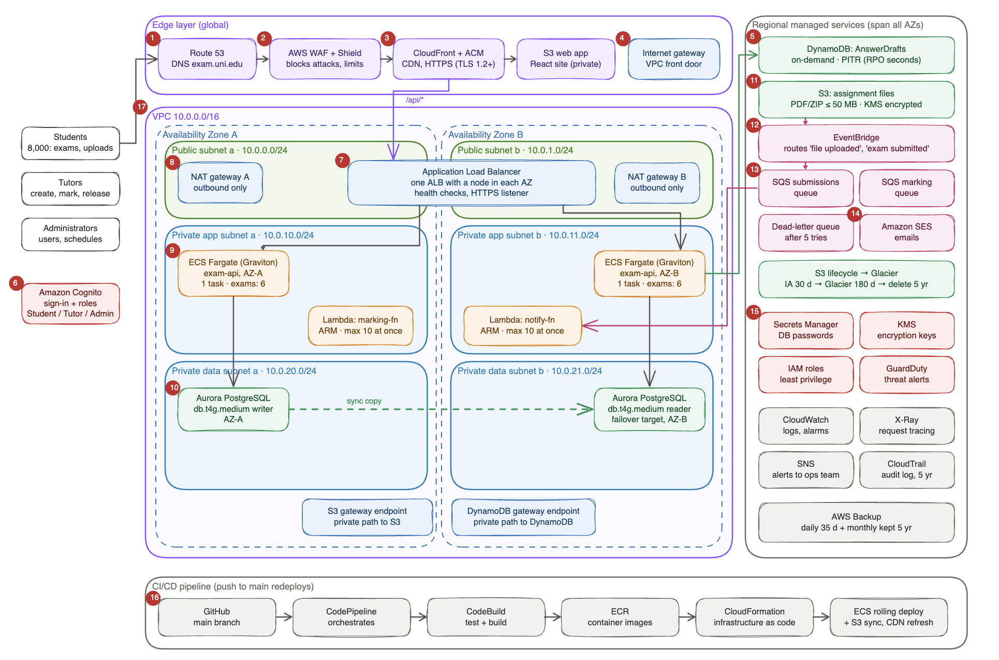
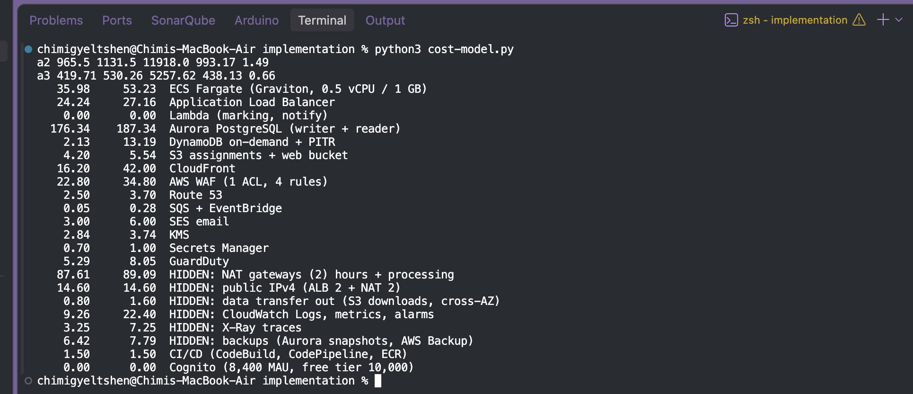

# Assignment 3: Cost, feasibility and failure analysis

The Assignment 2 exam platform, costed for **Asia Pacific (Singapore) `ap-southeast-1`**, trimmed to a cost-optimised design, and tested for failures and load.



## Answer in one table

| Question | Answer |
|---|---|
| Normal month (10 per year) | **$419.71** |
| Exam month (2 per year) | **$530.26** |
| Annual total | **$5,257.62** (average **$438.13/month**) |
| Cost per student | **$0.66 per year** |
| Budget ($1,000/month averaged) | ✅ Met at 44% of the budget |
| Peak (3,000 starts in 5 minutes) | ✅ With 12 scheduled Fargate tasks + DynamoDB on-demand; lab 100× spike passed |
| RPO 5 minutes / RTO 1 hour | ✅ About 0 / about 1 minute for AZ, instance and task failures |
| Survives one AZ | ✅ Yes |
| Remaining accepted risk | Loss of the whole Singapore Region (SPOF 17) |
| Most expensive | Aurora (41%), NAT gateways (20%), Fargate (9%) |
| Saving against Assignment 2 | **−$545.79/month (−57%)** |
| Prices checked | **24 November 2026**, AWS Price List API (same data as the AWS Pricing Calculator), USD |

## Where each task is answered

| Task | File |
|---|---|
| **Task 1:** revised architecture, single points of failure, change log | [`architecture/spof-and-changelog.md`](architecture/spof-and-changelog.md) · diagram [`architecture-a3.png`](architecture/architecture-a3.png) / [`.svg`](architecture/architecture-a3.svg) / [`.excalidraw`](architecture/architecture-a3.excalidraw) |
| **Task 2.1:** monthly cost per service, annual, per student, hidden costs | [`docs/cost-report.md`](docs/cost-report.md#1-monthly-cost-per-service-annual-total-and-cost-per-student) |
| **Task 2.2:** three most expensive components | [`docs/cost-report.md`](docs/cost-report.md#2-the-three-most-expensive-components) |
| **Task 2.3:** five service comparisons | [`docs/service-comparisons.md`](docs/service-comparisons.md) |
| **Task 2.4:** Singapore vs Mumbai, with measured latency from Bhutan | [`docs/service-comparisons.md`](docs/service-comparisons.md#4-region-comparison-singapore-vs-mumbai-including-latency-from-bhutan) |
| **Task 2.5:** feasibility verdict | [`docs/cost-report.md`](docs/cost-report.md#5-feasibility-verdict) |
| Price sources and dates | [`docs/pricing-sources.md`](docs/pricing-sources.md) |
| **Task 3:** costed estimate (calculator inputs for both profiles + 6 optimisations with savings) | [`implementation/costed-estimate.md`](implementation/costed-estimate.md) |
| **Task 3:** failure tests (4 scenarios + 1 reasoned) | [`implementation/failure-tests.md`](implementation/failure-tests.md) |
| **Task 3:** load test and bottlenecks | [`implementation/load-test.md`](implementation/load-test.md) |
| Cost model (re-run to check every number) | [`implementation/cost-model.py`](implementation/cost-model.py) → [`cost-model-output.json`](implementation/cost-model-output.json) |
| Lab files for every test | [`implementation/lab/`](implementation/lab/) |
| Evidence checklist | [`evidence/README.md`](evidence/README.md) |

## What changed from Assignment 2 (short version)

| Change | Saving per month |
|---|---:|
| Aurora 2 × db.r6g.large → 2 × db.t4g.medium | $290.54 |
| ElastiCache Redis removed (exam paper cached in task memory) | $70.08 |
| x86 4-task baseline → Graviton 2-task baseline, scheduled to 12 for exams | $53.98 |
| RDS Proxy removed (Lambda reserved concurrency 10) | $52.56 |
| Backups: monthly kept 5 years, no cross-Region copy | $44.43 |
| Logging: 30-day retention, INFO level, 5% tracing | $32.79 |
| Fewer secrets and keys | $1.40 |
| **Kept on purpose:** 2 NAT gateways, Aurora reader in AZ-B, ALB in both AZs | — |

## Re-run the cost model

```
cd assignment-3/implementation
python3 cost-model.py
```
