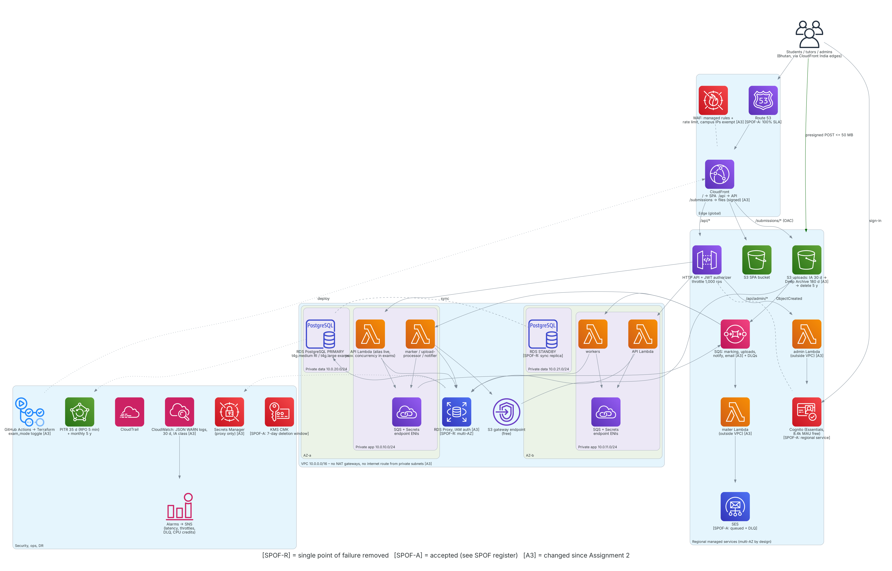

# Revised architecture (Assignment 3)

`architecture.png` is generated from [`diagram.py`](diagram.py). The Assignment 2 diagram is kept as [`architecture-a2.png`](architecture-a2.png), with its write-up in [`assignment2.md`](assignment2.md).

**Region:** Asia Pacific (Singapore) `ap-southeast-1`, two Availability Zones. WAF and the CloudFront certificate stay in `us-east-1`, as CloudFront requires.

## What changed and why

Every change is tied to a finding: either a cost in [`docs/cost-report.md`](../docs/cost-report.md) or a test in [`infra/failure-tests.md`](../infra/failure-tests.md) / [`infra/load-test.md`](../infra/load-test.md).

| # | Area | Assignment 2 | Assignment 3 | Driven by | Effect (USD/yr) |
|---|---|---|---|---|---|
| C1 | Region | ap-south-1 (Mumbai) | **ap-southeast-1 (Singapore)** | Brief | Mumbai would be ≈ $335/yr cheaper and closer to Bhutan (cost report §4) |
| C2 | Egress from private subnets | 2 NAT gateways (one per AZ) | **No NAT.** S3 gateway endpoint (free); SQS and Secrets Manager interface endpoints in both AZs | Cost: NAT was the 2nd most expensive item | −$581 |
| C3 | DB authentication | Lambdas read the DB secret from Secrets Manager | **IAM auth to RDS Proxy.** Token signed locally; no runtime call to Secrets Manager | Needed to drop NAT; removes a runtime dependency | (part of C2) |
| C4 | Email | Workers in the VPC called SES | **email queue → mailer Lambda outside the VPC**, max concurrency 5 | Drop NAT; load-test bottleneck #3 (SES rate) | (part of C2) |
| C5 | Admin API | In the VPC API Lambda | **admin Lambda outside the VPC** (Cognito only) | Drop NAT | (part of C2) |
| C6 | DB capacity | db.t4g.medium on-demand all year | **1-yr Reserved t4g.medium**; **exam_mode** raises it to t4g.large for the 2 exam months | Cost (RI) + load test (CPU credits) | −$480 RI, +$296 exam upsizing, −$5 burst credits avoided |
| C7 | API cold starts | No provisioned concurrency | **Alias `live` + 100 provisioned concurrency in exam_mode** | Load-test bottleneck #1 (throttling / cold starts at exam start) | +$72 |
| C8 | Logs and tracing | INFO logs, platform lines, 90 days, X-Ray on | **JSON logs at WARN**, platform lines dropped, 30 days, access and flow logs in **Infrequent Access**, X-Ray removed | Cost: hidden CloudWatch/X-Ray cost | −$252 |
| C9 | File archive | Glacier Flexible Retrieval after 180 d | **Glacier Deep Archive** after 180 d | Cost (5-year retention) | −$9 in year 1, −$285/yr by year 5 |
| C10 | Tutor downloads | S3 presigned GET ($0.12/GB) | **CloudFront signed URLs** (1 TB/month free) | Hidden cost: data transfer out | −$110 |
| C11 | Backups | RDS PITR **and** daily AWS Backup copies | RDS PITR (35 d) + monthly AWS Backup (5 y) only | Cost: duplicate backups | −$31 |
| C12 | WAF | Per-IP rate limit for everyone | Rate limit **skips campus NAT IPs** (`campus_cidrs`) | Failure test 4 (exam hall blocked) | +$1/month |
| C13 | Alarms and dashboard | Basic | p95 latency, throttles, provisioned-concurrency spillover, CPU credits, proxy connections; dashboard doubles as load-test evidence | Load test needs CloudWatch proof | +$5 |

Net effect: **$5,181 → $4,089 per year (−21 %)**, while also fixing three load-test bottlenecks.

## Single points of failure

| Component | SPOF? | How it is handled | Status |
|---|---|---|---|
| RDS primary instance | Yes in single-AZ | Multi-AZ synchronous standby, automatic failover in about 1–2 min | **Removed** |
| RDS Proxy | No | Managed and spread over both app subnets | **Removed** |
| NAT gateway (A2 demo used a single one) | Yes | NAT removed entirely; endpoints have an ENI in each AZ | **Removed** |
| Interface endpoints (SQS, Secrets) | No | One ENI per AZ; private DNS fails over | **Removed** |
| Lambda capacity (account concurrency pool) | Yes (load test) | Provisioned concurrency on the API alias, event-source max concurrency on workers, quota increase before exams | **Removed** |
| WAF rate rule vs. a shared campus IP | Yes (failure test 4) | Campus CIDRs exempt from the rate rule | **Removed** |
| Bad deployment | Yes (failure test 3) | Pipeline tests, `live` alias; rollback = revert and push (measured RTO) | **Mitigated** |
| SES / email | Partly | Every email is queued; failures retry, then go to the DLQ with an alarm and can be redriven | **Accepted** (email may be late, never lost) |
| Cognito user pool | Regional service | Multi-AZ inside the Region; no cross-region replica exists | **Accepted** |
| KMS key | Yes (if deleted) | Rotation on, 7-day deletion window, only admins can schedule deletion | **Accepted** |
| AWS Region (Singapore) | Yes | Out of scope for a 1-hour RTO; option: cross-region snapshot copy (about $5/month) | **Accepted** and documented |
| Route 53 / CloudFront | Global | 100 % SLA (Route 53); CloudFront has hundreds of edges | **Accepted** |
| GitHub / CI | Not in the request path | Only affects deployments; Terraform can be run from a laptop | **Accepted** |

## Tiers (revised)

| Tier | Components |
|---|---|
| Edge | Route 53 → CloudFront (SPA, `/api/*`, `/submissions/*` signed) + WAF |
| Identity | Cognito Essentials (8,400 MAU, inside the 10,000 free tier) |
| API | API Gateway HTTP API, JWT authorizer, 1,000 rps throttle → Lambda alias `live` |
| Compute | VPC Lambdas: `api`, `marker`, `upload-processor`, `notifier`, `migrate` (private app subnets, both AZs). Non-VPC Lambdas: `mailer`, `admin` |
| Data | RDS PostgreSQL Multi-AZ (t4g.medium RI; t4g.large in exam_mode) behind RDS Proxy (IAM auth) |
| Storage | S3 uploads (SSE-KMS, versioned) Standard → IA 30 d → Deep Archive 180 d → delete 5 y |
| Async | SQS `marking`, `uploads`, `notify`, `email` + DLQs; SES |
| Network | VPC with no NAT and no internet route from private subnets; S3 gateway endpoint; SQS and Secrets Manager interface endpoints |
| Ops | CloudWatch (JSON WARN logs, 30 d, IA class), alarms → SNS, dashboard; CloudTrail; AWS Backup monthly, kept 5 y |
| CI/CD | GitHub Actions (OIDC) → Terraform; `exam_mode` is a one-line change, pushed to `main` |

## Walkthroughs (changes since Assignment 2)

The walkthroughs in [`assignment2.md`](assignment2.md) still apply, with these differences:

1. **Exam open and autosave:** API Gateway now invokes the `live` alias. In exam months, 100 pre-initialised environments answer the 9:00 rush with no cold start. The Lambda connects to RDS Proxy with an IAM token, so there is no Secrets Manager call.
2. **40 MB upload and tutor notification:** `upload-processor` puts the email on the `email` queue instead of calling SES, and `mailer` (outside the VPC) sends it. The tutor's download link is a CloudFront signed URL valid for 15 minutes.
