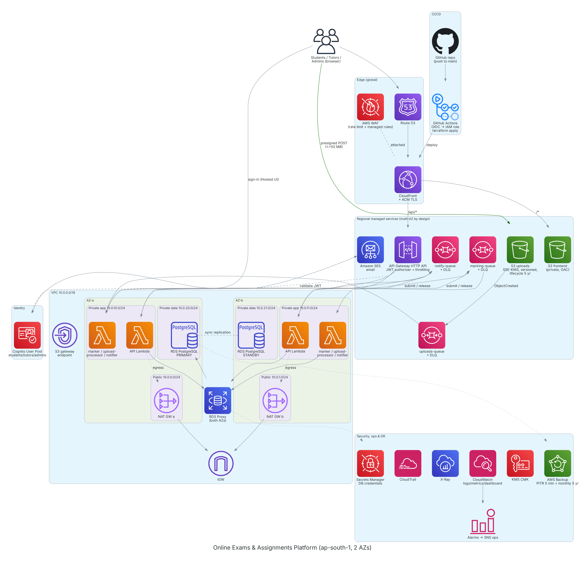
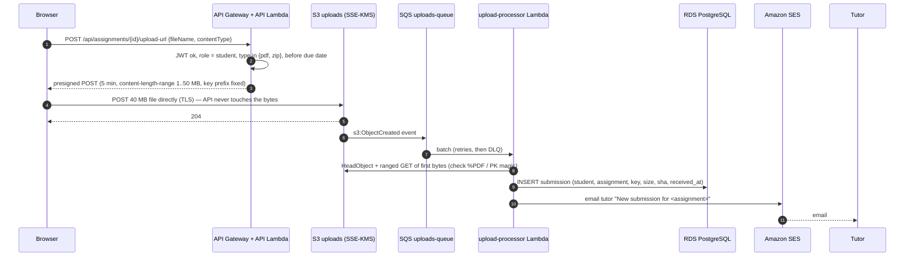

# Assignment 2 architecture (kept for reference – see README.md for the revised design)



`architecture-a2.png` is generated from `diagram_a2.py` (Python `diagrams` library), so the diagram is versioned as code.

## Tiers at a glance

| Tier | Components | Placement |
|---|---|---|
| Edge | Route 53, CloudFront, AWS WAF, ACM | Global (WAF/ACM in us-east-1) |
| Frontend | S3 static site bucket (private, CloudFront Origin Access Control) | Regional, multi-AZ by design |
| Authentication | Cognito User Pool + Hosted UI, groups `students`, `tutors`, `admins` | Regional, multi-AZ by design |
| API | API Gateway HTTP API (`/api/*` behind CloudFront), JWT authorizer, throttling | Regional, multi-AZ by design |
| Compute | Lambda: `api`, `marker`, `upload-processor`, `notifier`, `migrate` | VPC **private app subnets** in AZ-a and AZ-b |
| Network | VPC 10.0.0.0/16; public subnets (NAT GW per AZ, IGW); private app subnets; private data subnets; S3 gateway endpoint | 2 AZs |
| Database | RDS PostgreSQL **Multi-AZ** (primary AZ-a, synchronous standby AZ-b) + RDS Proxy | VPC **private data subnets**, not publicly accessible |
| File storage | S3 uploads bucket: SSE-KMS, versioning, block public access, lifecycle Standard → Standard-IA (30 d) → Glacier Flexible Retrieval (180 d) → delete after 5 years | Regional |
| Async | SQS `uploads-queue`, `marking-queue`, `notify-queue` (each with DLQ); SES for email | Regional |
| Secrets & keys | Secrets Manager (RDS-managed master secret), KMS customer-managed key | Regional |
| Monitoring | CloudWatch logs, metrics, dashboard, alarms → SNS ops topic; X-Ray tracing; CloudTrail | Regional |
| Backup / DR | RDS automated backups (35-day PITR, transaction logs shipped every 5 min); AWS Backup monthly snapshots kept 5 years | Regional |
| CI/CD | GitHub Actions → OIDC → IAM deploy role → `terraform apply`, frontend sync, CloudFront invalidation, DB migration | — |

## Walkthrough 1 – A student opens an exam and answers autosave

```mermaid
sequenceDiagram
  autonumber
  participant B as Browser
  participant CG as Cognito
  participant CF as CloudFront + WAF
  participant AG as API Gateway
  participant L as API Lambda (private subnet)
  participant P as RDS Proxy
  participant DB as RDS PostgreSQL (Multi-AZ)
  B->>CG: Sign in (Hosted UI, auth code + PKCE)
  CG-->>B: ID/access JWT (group = students)
  B->>CF: GET / (SPA from S3 via OAC, cached at edge)
  B->>CF: POST /api/exams/{id}/start  (Bearer JWT)
  CF->>AG: WAF rules + rate limit pass, forward /api/*
  AG->>AG: JWT authorizer validates signature, expiry, audience
  AG->>L: Invoke with claims (sub, cognito:groups)
  L->>P: INSERT attempt (deadline = now + duration) ON CONFLICT return existing
  P->>DB: pooled connection
  L-->>B: questions (no answer keys) + server deadline
  loop every 30 s
    B->>CF: PUT /api/attempts/{id}/answers {answers, clientSeq}
    CF->>AG: forward
    AG->>L: invoke
    L->>DB: UPSERT answers WHERE now() <= deadline + 60 s grace AND clientSeq is newer
    DB-->>L: committed (sync-replicated to standby in AZ-b)
    L-->>B: 200 {savedAt}
  end
  B->>CF: POST /api/attempts/{id}/submit
  L->>DB: status = submitted
  L->>SQS marking-queue: {attemptId}
  Note over L: marker Lambda auto-marks MCQs, stores score; short answers wait for tutor
```

1. The student signs in through the Cognito Hosted UI and receives JWTs that carry the `students` group.
2. CloudFront serves the single-page app from the private S3 bucket (cached at the edge); WAF inspects every request.
3. `POST /api/exams/{id}/start` is routed by CloudFront to API Gateway, whose JWT authorizer rejects bad tokens before any Lambda runs.
4. The API Lambda in a private subnet creates (or resumes) the attempt in PostgreSQL through RDS Proxy and returns the questions **without** answer keys plus a server-side deadline.
5. Every 30 s the browser sends `PUT /api/attempts/{id}/answers`. The Lambda upserts the answer set only if the attempt is still open; the write is synchronously replicated to the standby in AZ-b before it is acknowledged. A copy is also kept in the browser's `localStorage`, so a network blip never loses work.
6. On submit (or deadline), the attempt is locked and a message goes to `marking-queue`; the `marker` Lambda auto-marks MCQs asynchronously.

## Walkthrough 2 – A student uploads a 40 MB assignment and the tutor is notified



1. The browser asks the API for an upload URL. The Lambda checks the role, due date and file type and returns an S3 **presigned POST** whose policy pins the object key prefix and enforces `content-length-range` ≤ 50 MB.
2. The browser uploads the 40 MB file straight to S3 over TLS; the object is encrypted with the KMS key. API Gateway's 10 MB payload limit and Lambda's 6 MB limit never come into play.
3. S3 emits `ObjectCreated` to `uploads-queue`. The `upload-processor` Lambda validates size and magic bytes, records the submission in PostgreSQL, and sends the tutor an email via SES. Failures retry automatically and land in the DLQ (alarmed) after 5 attempts.
4. Lifecycle rules then move the file to Standard-IA after 30 days, Glacier after 180 days, and delete it after 5 years.

## How the design handles the exam peak and the loss of one AZ (≈280 words)

**Peak.** 3,000 students starting within 5 minutes is about 10 starts/s, then 3,000 ÷ 30 s ≈ 100 autosave writes/s — small requests. The SPA is served by CloudFront from edge cache, so page loads never hit the region. API Gateway and Lambda scale per request with no warm-up of servers; Lambda reserved concurrency (300) caps the fleet so it cannot exhaust the database, and RDS Proxy multiplexes those invocations onto a small pool of PostgreSQL connections. Autosave is a single-row upsert keyed by attempt, which PostgreSQL handles easily at this rate. Slow work — MCQ marking, file checks and emails — is pushed onto SQS, so a burst of submissions at the deadline is queued and drained steadily instead of competing with live exams. 50 MB uploads go directly to S3 with presigned POSTs, so they consume no API or Lambda capacity. WAF rate-based rules and API Gateway throttling protect against abuse, and before each exam week we pre-scale the DB class and pre-warm with provisioned concurrency.

**Loss of one AZ.** Every tier spans two AZs. CloudFront, S3, API Gateway, Cognito, SQS and SES are regional services that already survive an AZ loss. Lambda runs in private subnets in both AZs and simply stops placing invocations in the failed one; each AZ has its own NAT gateway so egress has no cross-AZ single point. RDS Multi-AZ replicates synchronously to the standby; if the primary's AZ fails, RDS promotes the standby and flips the DNS endpoint in roughly 60–120 s, and RDS Proxy reduces that pause for clients. Because replication is synchronous no committed answer is lost (RPO ≈ 0, well within 5 minutes), and the browser's local copy re-sends anything unsent. Recovery is automatic, far inside the 1-hour RTO.
