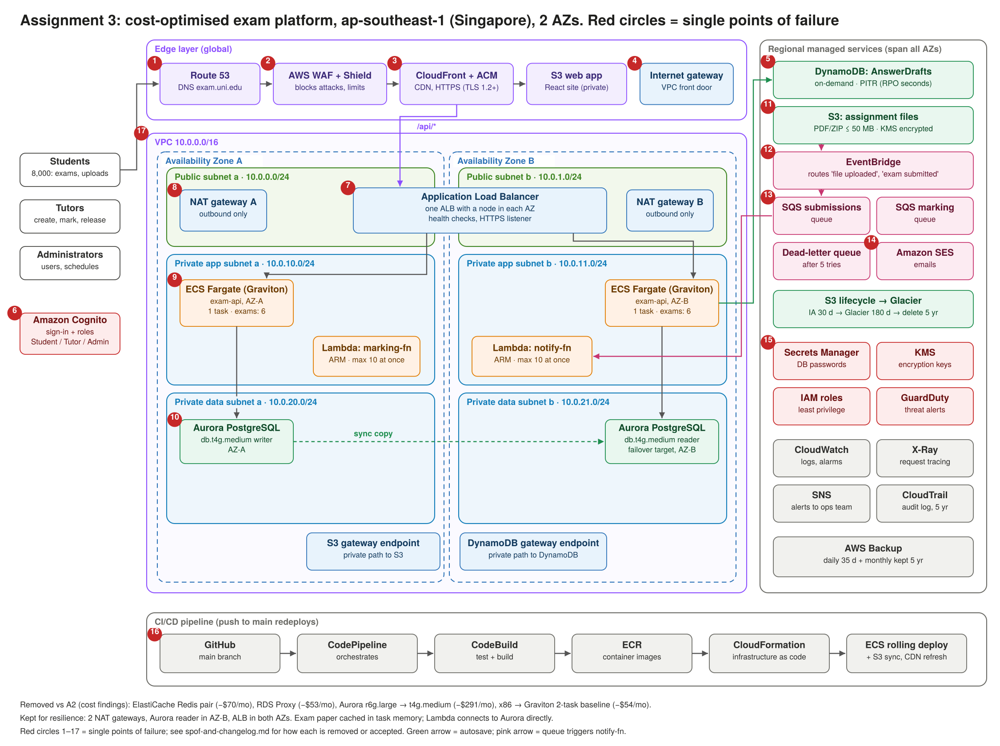

# Task 1: Revised architecture, single points of failure and change log

The design is the Assignment 2 platform, re-costed in Singapore and trimmed wherever the cost model or the lab tests showed that a part cost more than it was worth. Each **red numbered circle** on the diagram marks a single point of failure (SPOF), and the table below says how each one is **removed** or **accepted**.

## Single points of failure

| # | Component | Why it could be a single point of failure | Status | How it is handled |
|---|---|---|---|---|
| 1 | Route 53 | Only DNS for `exam.uni.edu` | **Removed** | Global anycast service with a 100% availability SLA; alias records point at CloudFront |
| 2 | AWS WAF + Shield | Every request passes through it; a badly set rate rule could block a whole campus | **Removed / mitigated** | Global managed service. The rate limit applies to `/login` only and is set above campus NAT volume: 3,000 students share a few public IPs, so a per-IP limit would block them. Rule changes go through CI/CD |
| 3 | CloudFront + ACM | The single entry point | **Removed** | Hundreds of edge locations. If the origin has trouble, the cached website still loads. ACM renews certificates automatically |
| 4 | Internet gateway | The only way in to the VPC | **Removed** | Redundant and horizontally scaled by AWS; it has no AZ |
| 5 | DynamoDB `AnswerDrafts` | Holds every autosave | **Removed** | Regional service spanning 3 AZs. Point-in-time recovery restores to any second in 35 days, so the RPO is seconds |
| 6 | Cognito | Every sign-in depends on it; the lab flagged it as "dependency concentration" | **Accepted** | Regional and multi-AZ by AWS. Sign-in tokens last 1 hour, so exams already in progress continue through a short outage |
| 7 | Application Load Balancer | All API traffic | **Removed** | Nodes in both public subnets. Health checks every 10 s, unhealthy after 2 failures, so a failed target is dropped in about 20 s |
| 8 | NAT gateway | A NAT gateway lives in one AZ | **Removed** | **Two** NAT gateways, one per AZ, and each private route table uses its own AZ's gateway. Kept despite costing $87.61/month (the second most expensive item), because one NAT gateway would break the AZ target |
| 9 | Fargate tasks | Normal months run **1 task per AZ** (the lab's Analyze tab flagged "replicas: 1") | **Accepted in normal months, removed in exam months** | Normal months: if one task fails, the other AZ's task carries 300–500 users while ECS starts a replacement in about 1–2 minutes. Exam months: a scheduled action runs **6 tasks per AZ** from 30 minutes before each exam, and target tracking can add more |
| 10 | Aurora writer (AZ-A) | One instance accepts all writes | **Removed** | The db.t4g.medium reader in AZ-B is promoted automatically in about 30–60 s (the lab reported about 35 s). Storage keeps 6 copies across 3 AZs, so RPO is about 0 |
| 11 | S3 assignment bucket | All submitted files | **Removed** | 11 nines of durability across 3 or more AZs; versioning protects against overwrites |
| 12 | EventBridge | Routes the "file uploaded" event | **Accepted** | Regional and managed. S3 retries event delivery for up to 24 h, and the file itself is already safe in S3 |
| 13 | SQS queues | Background jobs | **Removed** | Messages stored across AZs. After 5 failed attempts they go to the dead-letter queue, which raises an alarm |
| 14 | Amazon SES | The only email sender | **Accepted** | If SES is down, emails wait in the queue and are retried; only notification timing is affected, not exams |
| 15 | Secrets Manager / KMS | Database password and encryption keys | **Accepted** | Regional and multi-AZ. Tasks cache the secret at start-up. KMS keys have a 30-day deletion waiting period and are protected by key policies |
| 16 | CI/CD pipeline | The only way to deploy | **Accepted** | Not on the request path: if it fails, the running system keeps working; only deployments wait |
| 17 | **The Singapore Region itself** | Everything runs in `ap-southeast-1` | **Accepted (costed)** | The brief only asks to survive the loss of one AZ. A Region outage would stop the service until AWS recovers it. **Optional fix:** copy AWS Backup snapshots and S3 files to Mumbai for about $5–$10/month (RTO hours, RPO up to 24 h). Not bought this year to keep within the agreed targets and budget |

## Change log against Assignment 2

Costs are for a normal month in Singapore; see [`../docs/cost-report.md`](../docs/cost-report.md).

| # | Change | Assignment 2 | Assignment 3 | Finding that led to it | Monthly effect |
|---|---|---|---|---|---:|
| 1 | Right-size Aurora | 2 × db.r6g.large ($0.313/h) | 2 × **db.t4g.medium** ($0.114/h) | Aurora was 48% of the A2 bill. Autosaves already go to DynamoDB, so the database only handles about 10 exam starts per second | **−$290.54** |
| 2 | Remove ElastiCache Redis | Primary + replica, cache.t4g.small | **Removed**; the exam paper is cached in each Fargate task's memory | The paper is small and read-only during an exam; 12 tasks each load it once | **−$70.08** |
| 3 | Remove RDS Proxy | Proxy in front of Aurora | **Removed**; Lambda connects directly with **reserved concurrency 10** | At most 10 Lambda connections, so a db.t4g.medium can't run out of connections | **−$52.56** |
| 4 | Graviton and a smaller baseline | 4 × x86 tasks always on, scaled to 12 | 2 × **Graviton (ARM)** tasks, scheduled to 12 for exams | Normal load (300–500 users) doesn't need 4 tasks; ARM is 20% cheaper per task-hour | **−$53.98** |
| 5 | Backup policy | Daily backups kept 5 years + cross-Region copy | Daily kept 35 days + **monthly kept 5 years**, in-Region | The 5-year rule is about keeping records, not daily restore points | **−$44.43** |
| 6 | Logging and tracing | Container Insights, DEBUG logs, 1-year retention, 20% tracing | INFO logs, **30-day retention**, 5% X-Ray sampling | CloudWatch was a hidden cost of $32/month | **−$32.79** |
| 7 | S3 lifecycle | Glacier after 365 days | Glacier after **180 days**; delete at 5 years | Old submissions are rarely opened | small; grows over the years |
| 8 | Secrets and keys | 2 secrets, 3 KMS keys | 1 secret, 2 keys (+ S3 Bucket Keys) | Fewer keys and fewer KMS requests | **−$1.40** |
| 9 | Exam-month scaling | Target tracking only | **Scheduled** scale-out 30 minutes before each exam + target tracking | Cold capacity at exam start was the main peak risk; scheduling is predictable | +$17 in exam months |
| 10 | Budget guardrail | none | **AWS Budgets** alert at 80% ($800) and 100% | Catches cost surprises early (first 2 budgets are free) | $0 |
| — | **Kept on purpose** | 2 NAT gateways, Aurora reader, ALB in both AZs, CloudFront + WAF | unchanged | These are what meet the "survive one AZ" target | — |
| | **Total** | **$965.50** normal / **$1,131.50** exam | **$419.71** normal / **$530.26** exam | | **−$545.79 (−57%)** |
